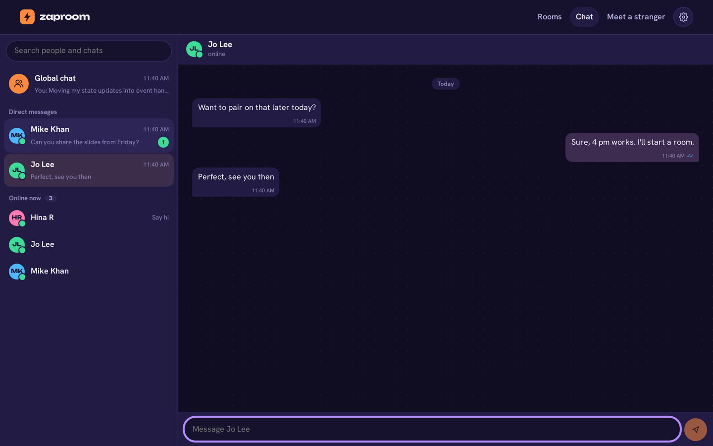
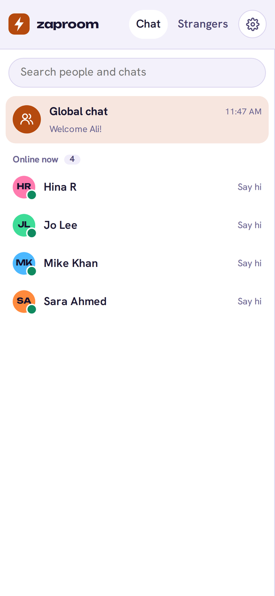
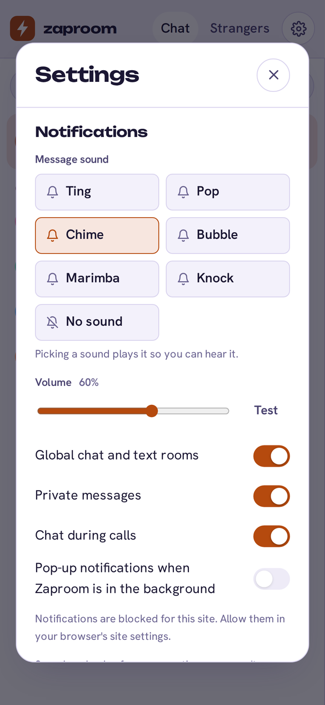
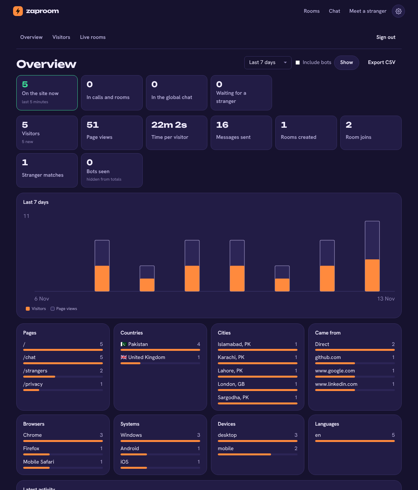
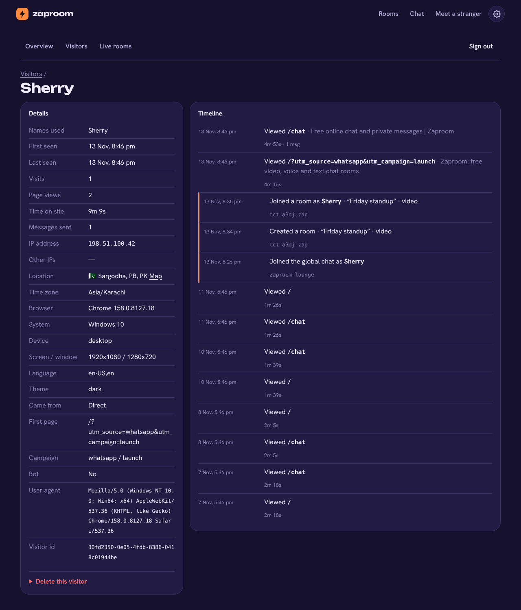
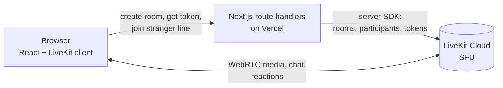

# Zaproom

Video, voice and text chat in the browser. Pick a name, start a room, step into one that's already talking, chat with everyone online, message someone privately, or get matched with a stranger. No sign-up, nothing to install.

**Live demo:** https://zaproom.vercel.app




## What it does

- **Rooms for up to 12 people** with video, voice, screen sharing (with tab audio), text chat and emoji reactions.
- **Global chat, like a group chat on your phone.** Everyone online in one group, a live list of who's here, and private one-to-one messages: tap a name to start. Typing indicators, unread counts, and ticks that turn blue when your message has been seen. An emoji picker with search and recently used emoji, and messages that are only emoji show large. Your private chats are saved on your device, so they're still there after a reload.
- **Text-only rooms** for up to 50 people, with "joined" and "left" notices and private messages inside the room. No camera or microphone permission is ever asked for.
- **Settings:** six notification sounds made in the browser (Ting, Pop, Chime, Bubble, Marimba, Knock) with preview and volume, separate switches for global chat, private messages and in-call chat, pop-up notifications when the tab is in the background, Enter-to-send, theme, and your name.
- **A live lobby.** Public rooms show who's inside and update every few seconds, along with how many people are online and how many are waiting to meet someone.
- **Private rooms** that only open from their link (`/r/k7f-2qxm-9zd`) and never appear in the lobby.
- **Voice-only rooms.** The server refuses camera tracks in them, so nobody can switch a camera on.
- **Meet a stranger.** Random one-to-one matching with the camera off by default. Press **Next** to skip, and if your match never connects you're put back in line automatically.
- **A pre-join screen** with a camera preview, a live mic meter, and camera and microphone pickers.
- **In the call:** speaking rings, mute indicators, connection quality bars, join and leave notices, an unread badge on chat, and clear messages when the connection drops or the room closes.
- **Admin panel** at `/admin`, behind a password. A visitor log in Postgres records each visitor's IP, approximate location, browser, device, screen, language, referrer and campaign tags, the pages they open and for how long, the names they use, and what they do (rooms created or joined, chat, stranger matches, messages sent, never message text). The overview has live counts, a daily chart and top pages, places, sources and devices. You can search visitors, open a full timeline for each one, export CSV, and delete a visitor's records. **Live rooms** lists every open room, private ones included, with who is inside: close a room or remove a person, and jump to that person's visitor record. The privacy page says exactly what is logged.
- **Light, dark and match-device themes** with no flash on load, a layout that works down to phone size, keyboard support throughout, and reduced motion respected.

| Live lobby | Light theme | On a phone |
| --- | --- | --- |
|  |  |  |

| Chat on a phone | Notification settings |
| --- | --- |
|  |  |

| Admin overview | One visitor's record |
| --- | --- |
|  |  |

## How it works



- **No database.** LiveKit is the source of truth. A room's name, topic, type and visibility live in its LiveKit metadata. The lobby is built from `listRooms` and `listParticipants`, and one lookup is shared by every visitor for 4 seconds.
- **Tokens are the only way in.** `/api/token` checks that the room exists and isn't full, then signs a 2-hour token for that one room. Voice rooms get a token that can't publish a camera. Nobody can create a room by guessing a name.
- **Stranger matching without shared memory.** Waiting means being connected to a hidden LiveKit room whose tokens can't publish anything, so closing the tab takes you out of line. Each poll lists that room and pairs people in join order (1st with 2nd, 3rd with 4th). Every request computes the same pairs, and both people get the same room id (a hash of the two identities), so two simultaneous polls on different serverless instances agree. Each poll carries an HMAC-signed ticket, so nobody can take someone else's match.
- **Chat and reactions** use LiveKit's data channels. Reactions are limited to six known emoji, and nothing is stored on a server.
- **Private messages without a message server.** Text chat is a LiveKit room whose tokens can only send data packets. The SFU stamps every packet with the sender's identity from their signed token, so names can't be faked, and private messages use `destinationIdentities`, so the server only delivers them to one person. Packets are validated with zod on arrival, and senders are limited to 6 messages every 6 seconds.
- **Identity that survives a reload.** Each browser keeps a random device key. The server turns it into a chat identity with an HMAC, so the identity stays the same across reloads but can't be claimed by anyone who only sees it. Opening chat in a second tab moves the session there and offers "Use it here" in the first.

### Security and privacy

- A strict Content Security Policy with a per-request nonce and `strict-dynamic`. There are no inline styles: avatar colours are classes, not `style` attributes. `connect-src` allows only LiveKit.
- `Permissions-Policy` limits camera, microphone and screen capture to this site. Also set: HSTS, `X-Frame-Options: DENY` and `frame-ancestors 'none'`.
- Every API route checks the request's origin, size limit and schema (zod), and rate-limits by IP.
- Room pages are `noindex`, and their titles never include the room name. If analytics is on, `/r/<id>` is rewritten to `/r/room` before anything is sent.
- The lobby shows names only for public rooms. Private rooms and stranger chats only add to the total number of people online.
- The admin panel uses a signed, HttpOnly, `SameSite=Strict` session cookie (12 hours; changing the password signs everyone out), a timing-safe password check and 5 sign-in tries per 15 minutes. Its actions are plain form posts checked for origin. The admin's own visits are not logged, and old records are deleted after a year.

## Tech stack

Next.js 16 (App Router), React 19, TypeScript (strict), LiveKit (`livekit-client`, `@livekit/components-react` hooks, `livekit-server-sdk`), Postgres (Neon) through `postgres.js` for the visitor log, zod and hand-written CSS. Vitest and Playwright (with axe) for tests, and GitHub Actions for CI. Fonts are Unbounded and Hanken Grotesk, self-hosted.

## Run it locally

You need Node 22+, pnpm, and a LiveKit server. Use either a free [LiveKit Cloud](https://cloud.livekit.io) project or a local one in Docker:

```bash
docker run --rm -p 7880:7880 -p 7881:7881 -p 7882:7882/udp \
  livekit/livekit-server --dev --bind 0.0.0.0 --node-ip 127.0.0.1
```

```bash
pnpm install
cp .env.example .env.local
# LiveKit Cloud: paste the URL, key and secret from Settings → Keys
# Local Docker:  LIVEKIT_URL=ws://localhost:7880  LIVEKIT_API_KEY=devkey  LIVEKIT_API_SECRET=secret
pnpm dev
```

Open http://localhost:3000 in two browser windows to call yourself.

| Variable | Required | What it's for |
| --- | --- | --- |
| `LIVEKIT_URL` | yes | `wss://<project>.livekit.cloud` |
| `LIVEKIT_API_KEY` / `LIVEKIT_API_SECRET` | yes | Signing tokens and calling the LiveKit server API |
| `SITE_URL` | in production | Canonical links, sitemap and Open Graph |
| `GA_MEASUREMENT_ID` | no | Google Analytics 4 |
| `GOOGLE_SITE_VERIFICATION` | no | Search Console HTML-tag verification |
| `DATABASE_URL` | for the visitor log | Postgres connection string (Neon from the Vercel Marketplace sets it). Tables are created on first use |
| `ADMIN_PASSWORD` | for `/admin` | 12 characters or more. Without it the admin panel stays switched off |
| `VISITOR_RETENTION_DAYS` | no | How long visitor records are kept (default 365) |
| `ADMIN_TIMEZONE` | no | Time zone for the admin's dates and daily chart (default `Asia/Karachi`) |

Without the LiveKit variables the site still runs and says that calls are switched off.

## Tests

```bash
pnpm lint && pnpm typecheck
pnpm test            # unit: validation, room ids, matching, tickets, rate limits, chat, settings, admin sessions
TEST_DATABASE_URL=postgres://… pnpm test   # also runs the visitor-log tests against a real Postgres
PW_CHROME=1 pnpm e2e # browser: lobby, forms, pre-join, themes, axe in both themes, headers, API guards (desktop + phone)
E2E_DATABASE_URL=postgres://… PW_CHROME=1 pnpm e2e   # adds the admin panel tests
pnpm e2e:call        # real calls: needs a LiveKit server and the env vars above
```

CI runs everything on each pull request. The **calls** job starts `livekit-server --dev` in Docker, then two and three browser contexts with fake cameras and mics meet in a room. They check that video plays and audio is attached, chat goes both ways, mute and reactions show up, the lobby count updates and leaving works. A stranger match, a skip and a re-match are tested the same way. Text chat gets the same treatment: three people in the global chat, a private message that the third person never receives, typing, seen ticks, the notification sound, saved history after a reload, the one-tab rule, and a text room with join and leave notices, and the emoji picker. The screenshots above come from that job.

## Deploy

1. Import the repo on Vercel.
2. Add `LIVEKIT_URL`, `LIVEKIT_API_KEY`, `LIVEKIT_API_SECRET` and `SITE_URL` (Production).
3. For the admin panel: Storage → add Neon (free), which sets `DATABASE_URL`, then add `ADMIN_PASSWORD`.
4. Deploy. Previews without LiveKit keys still build and show the "calls are switched off" notice.

## Project layout

```
src/
  app/                 pages, route handlers (api/rooms, api/token, api/strangers/*), SEO files
  components/lobby/    live room list, start-a-room form
  components/room/     pre-join, call, tiles, controls, chat and people panel, reactions
  components/strangers stranger matching screen
  lib/                 validation, room metadata, pairing, signed tickets, rate limiting, LiveKit calls
  proxy.ts             per-request CSP nonce
tests/unit, tests/e2e
```

## History

This repo started in 2025 as **zapcall**, a two-person WebRTC demo (React 16, Socket.IO signalling, one STUN server). In November 2026 it was rebuilt as Zaproom on Next.js and LiveKit. The rebuild added group calls through a media server, a TURN relay for strict networks, chat, a lobby and stranger matching.

## License

MIT
